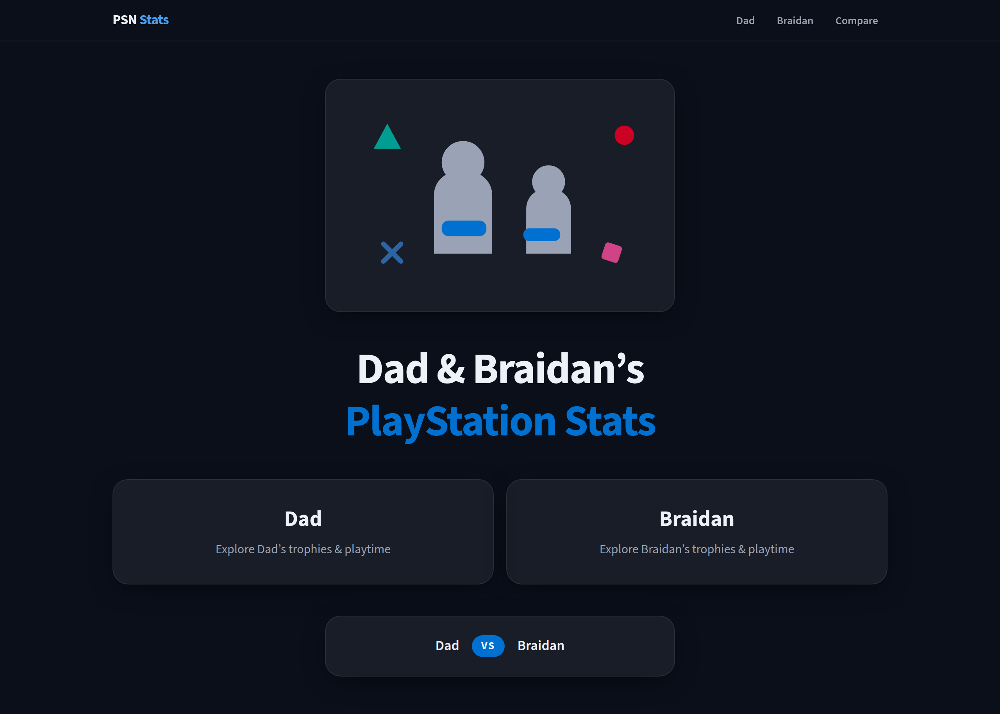
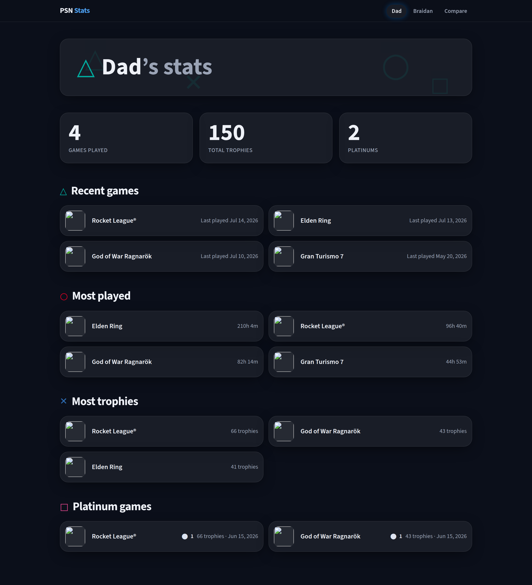
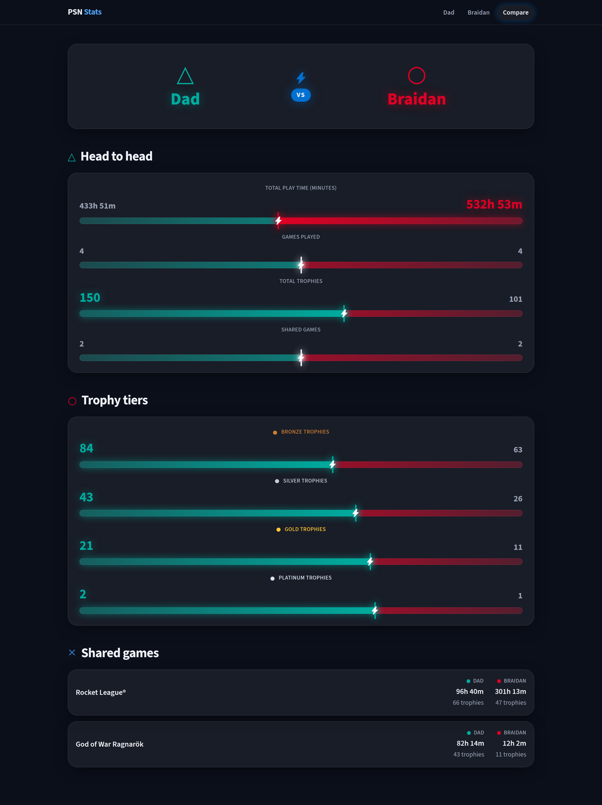
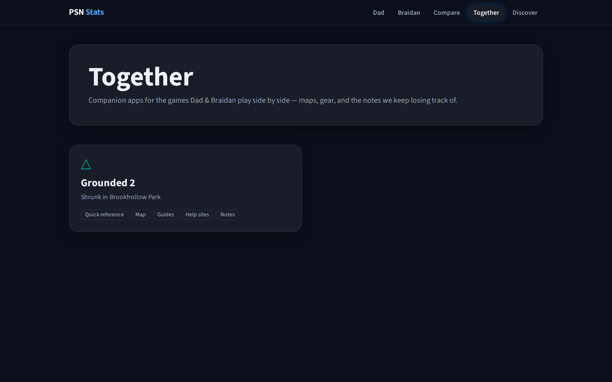
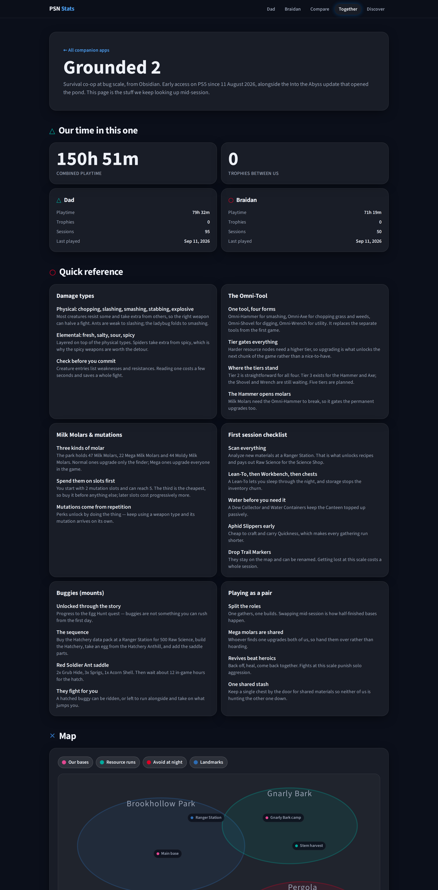

# psn — father & son PlayStation stats

A stats site for two players — Dad and Braidan — tracking what we play and the trophies we earn. A splash page links to each player's stats (recent games, most played, trophy leaders, platinums) and a head-to-head comparison, and a **Together** section holds a [companion app](#companion-apps) per game we play side by side. The site ships as a dark, PlayStation-vibe UI (see [Design language](#design-language) below); the data layer that feeds it is described further down.

## How it works

```
PSN API ──> pnpm sync ──> data/<player>/<date>.json ──> src/stats ──> site
            (psn-api)      committed snapshots           pure functions   React + Tailwind + Motion
```

- **Sync** (`src/psn`, `src/cli`): authenticates with PSN via NPSSO tokens and pulls each player's played titles (play time, play counts, last played) and trophy titles (earned tiers, platinums, progress).
- **Snapshots** (`data/`): one JSON per player per day plus `latest.json`, committed to git — the history doubles as the dataset for trend analytics later.
- **Stats** (`src/stats`): pure functions over snapshots — recent games, most played, trophy leaders, platinum list, and a full player-vs-player comparison. The site reads only this layer.
- **Site** (`site/`): a React + Vite app that renders the stats as a dark, PlayStation-vibe UI — a splash landing, a per-player page, a head-to-head compare view, the [companion apps](#companion-apps) for the games we play together, and the [help desk](#help-desk-ai-chat) chat. See [Design language](#design-language).
- **Chat server** (`server/`): the one non-static piece — a small Node service that fronts Gemini for the help desk so the API key never reaches the browser, and that serves the built site in the Docker image.

## Setup

```bash
pnpm install
cp .env.example .env    # then fill in NPSSO tokens (see below)
pnpm sync               # pull real data for all configured players
pnpm sync --dry-run     # exercise the pipeline with sample data, no credentials
```

**Getting an NPSSO token**: log in at [playstation.com](https://www.playstation.com), then visit [ca.account.sony.com/api/v1/ssocookie](https://ca.account.sony.com/api/v1/ssocookie) and copy the `npsso` value into `.env`. Tokens last ~2 months; when sync starts failing with an auth error naming your env var, grab a fresh one.

Players are declared in [`psn.config.json`](./psn.config.json). Each player either signs in with their own token (`mode: "npsso"`) or is fetched through another account's session (`mode: "friend"`, requires friendship and open privacy settings).

**Automated daily sync**: the [`Daily sync`](./.github/workflows/sync.yml) GitHub Actions workflow runs `pnpm sync` every day at 11:00 UTC (6:00 AM US Central during daylight time; 5:00 AM during standard time — GitHub cron is UTC-only and doesn't follow DST) and commits any changed snapshots under `data/` back to `main`, so history accumulates without a manual run. It reads the NPSSO tokens from repo secrets — add them at **repo Settings → Secrets and variables → Actions** as `NPSSO_DAD`, `NPSSO_BRAIDAN`, and `NPSSO_NADIA` — one per player in `psn.config.json` (an agent can't set these for you). Because the NPSSO tokens last ~2 months (see above), the workflow will start failing with a per-player auth error when one expires — or when a configured player has no secret yet; GitHub's workflow-failure notification is your cue to refresh or add the affected token and re-run the workflow (it also has a manual "Run workflow" trigger for testing).

**Game suggestions** (`src/suggestions/`): after the PSN sync, `pnpm sync` refreshes `data/suggestions.json` — unowned games suggested from the top genres at least two players share (ranked by the whole roster's combined playtime), sourced from the [RAWG](https://rawg.io) API (see the [#9 spike write-up](./docs/game-suggestions-spike.md) for why RAWG was chosen). This needs a `RAWG_API_KEY` (free at [rawg.io/apidocs](https://rawg.io/apidocs)) in `.env` locally, or as the `RAWG_API_KEY` repo secret for the daily sync workflow; without it, this step is skipped with a warning rather than failing the sync. Pass `--no-suggestions` to skip it explicitly. A `data/suggestions-cache.json` (title → RAWG genres) is committed alongside it so repeat syncs only fetch genres for newly-seen titles. For manual corrections (hiding a misclassified game, adding an edge case RAWG tags poorly), add a gitignored `data/suggestions-overrides.json` — see `src/suggestions/overrides.ts` for its shape.

## Commands

| Purpose | Command |
|---|---|
| Lint / typecheck / test / build | `pnpm lint` / `pnpm typecheck` / `pnpm test` / `pnpm build` |
| Sync all players | `pnpm sync` |
| Sync one player | `pnpm sync --player braidan` |
| Sync without refreshing suggestions | `pnpm sync --no-suggestions` |
| Credential-free pipeline check | `pnpm sync --dry-run` |
| Help-desk chat server (dev / tests) | `pnpm --filter chat-server dev` / `pnpm --filter chat-server test` |

## Design language

The site is a dark, PlayStation-vibe UI — no light mode, no Sony logos or trademarked assets; the
vibe comes from original silhouettes, the four shape glyphs (△ ○ ✕ □), and trophy-metal accents.

|  |  |
|---|---|
|  |  |
| **Splash** — animated hero, one portal card per player, VS compare CTA | **Player** — hero header, animated stat tiles, staggered game sections |



**Compare** — VS hero, a clash-meter scoreboard with a proportional lightning seam and winner-accent glow, trophy tiers, and a shared-games list.

The design is built on three layers, all under `site/src/`:

- **Tokens** — `styles/theme.css` holds a CSS-first Tailwind 4 `@theme` block: the surface scale,
  PS-blue accent, decorative shape colors, trophy metals, type scale, radii, and glow shadows. It's
  the single source of truth for those — components use the generated token utilities and never
  hardcode colors or shadows. (Motion timing lives separately in `motion/presets.ts`, below.)
- **Component kit** — `components/` provides the reusable primitives every view composes: `GlassCard`
  (the shared elevated glass surface), `StatTile`, `TrophyBadge`, `SectionHeader`, `AnimatedNumber`,
  and `GameSection`. `AppShell` is the persistent header/nav every route renders inside.
- **Motion** — `motion/presets.ts` defines shared entrance/hover/ambient presets (`fadeRise`,
  `staggerChildren`, `glowPulse`) with tokenized timing. Everything honours `prefers-reduced-motion`.

Building a new view or component? The hard rules — token vocabulary, composing the kit, animation,
PS-vibe boundaries, and a per-view ship checklist — live in [`AGENTS.md`](./AGENTS.md#designing-views--components).

## Companion apps

**Together** (`/together`) is a grid of the games we actually play as a pair; each tile opens that
title's companion app — the stuff worth having on a second screen mid-session.

|  |  |
|---|---|
|  |  |
| **Together** — one tile per title, tagged with the modules it has | **Companion** — our stats on the title, quick reference, map, guides, links, notes |

A companion app is assembled from optional modules, and a title renders exactly the ones it has
content for — so a new game can ship with just a links list and grow:

| Module | What it holds |
|---|---|
| **Our time in this one** | Combined and per-player playtime, trophies and last session, derived from the synced snapshots by `titleStats` — the only module that isn't hand-written |
| **Quick reference** | The one-screen cheat sheet: grouped term/detail pairs |
| **Map** | An original, hand-drawn zone sketch with category-filterable pins and per-pin notes — never in-game map art |
| **Guides** | Sortable, filterable reference tables (equipment, materials) |
| **Help sites** | Curated outbound links, each with a line on why it's worth opening |
| **Videos** | Embedded YouTube walkthroughs (privacy-friendly `youtube-nocookie` host) |
| **Our notes** | House rules, plans, reminders — the part no wiki has |

**Adding a title** is one content file plus one line of registry. The
[`add-companion-app`](./.claude/skills/add-companion-app/SKILL.md) skill walks the whole job,
including a lookup script that works out which PSN titles and trophy lists actually belong to the
game — the one step where a plausible guess silently shows another game's numbers. By hand:

1. Write `site/src/companions/<slug>.ts` exporting a `Companion` (see
   [`grounded-2.ts`](./site/src/companions/grounded-2.ts) and the module shapes in
   [`types.ts`](./site/src/companions/types.ts)). Set `psnTitleNames` to every name PSN spells the
   game by, across played titles and trophy lists — that's how the stats module finds it.
2. Add it to the `companions` array in [`site/src/companions/index.ts`](./site/src/companions/index.ts).

The grid, the routes, the section accents and the tests all derive from that registry, so nothing
else changes. Content is plain data: no component reads markup from a companion file.

## Help desk (AI chat)

**Help** (`/help`) is a controlled chat bot for one job: *how do I do this thing in a game?* Ask
about a boss, a recipe, a trophy or a setting and it answers in a few sentences with **at least one
written guide link and one YouTube link** to check the answer against. Anything that isn't a
question about playing a game gets a polite one-line no. Every companion app has a "Stuck? Ask the
help desk" link that opens the chat with that game pre-selected.

The bot is a [Gemini](https://ai.google.dev) model behind a small server of our own
(`server/`, the `chat-server` workspace package), because a browser can't hold the API key. The
server is where the control lives, and the UI can't loosen it:

- a system prompt that limits the model to game help, caps answers at ~120 words, and demands real
  URLs of both kinds — the model runs with Google Search grounding so it cites pages it actually read;
- a source contract enforced in code: articles and videos are classified by URL (not by what the
  model labelled them), deduped against the grounding metadata, and if either kind is missing the
  slot is filled with a clearly-labelled search link for the question rather than an invented URL;
- per-client and server-wide rate limits (10 and 60 questions a minute by default), request size and
  history caps, and a stock decline when Gemini's safety filters block a prompt.

**Running it locally** needs a Gemini API key (free at [aistudio.google.com](https://aistudio.google.com/apikey))
in `.env` as `GEMINI_API_KEY`, then two terminals:

```bash
pnpm --filter chat-server dev    # API on :8787, reads ../.env
pnpm --filter site dev           # Vite proxies /api to it
```

Without a server running, the page still renders and reports the help desk offline when you ask.
`pnpm --filter chat-server test` covers the whole server with fixtures and a fake Gemini — no key or
network needed.

**Deploying**: the site is static on Amplify Hosting ([`amplify.yml`](./amplify.yml)), which can't
run the server, so the server runs as an **AWS Lambda function behind a public function URL** — it
scales to zero and costs nothing idle. [`server/deploy/aws-lambda.sh`](./server/deploy/aws-lambda.sh)
does the whole rollout idempotently: an execution role, the function (Node 22 + the
[Lambda Web Adapter](https://github.com/awslabs/aws-lambda-web-adapter) layer, so the server runs
unchanged), its environment, the function URL, a health check, and — with `--amplify-app <appId>` —
it merges `VITE_CHAT_API_URL` into the Amplify app's variables, sets the Lambda's
`CHAT_ALLOWED_ORIGIN` to the site's domains, and starts a release build so the live site picks it
up:

```bash
pnpm --filter chat-server build
AWS_REGION=us-east-1 GEMINI_API_KEY=… server/deploy/aws-lambda.sh --amplify-app <appId>
```

The [`Deploy chat server`](./.github/workflows/deploy-server.yml) workflow runs the same script on
every push to `main` that touches `server/` (and on demand). It needs the `AWS_ACCESS_KEY_ID`,
`AWS_SECRET_ACCESS_KEY` and `GEMINI_API_KEY` secrets plus the `AWS_REGION` and `AMPLIFY_APP_ID`
repository variables. Optional server settings (`GEMINI_MODEL`, `CHAT_RATE_LIMIT_PER_MINUTE`,
`CHAT_GLOBAL_RATE_LIMIT_PER_MINUTE`) are passed through from the script's environment, and one
left unset keeps the value already on the function, so a CI re-run never reverts an override set
by hand. The script also caps the function's reserved concurrency (default 2): the rate limit is
in-memory per instance, so that bounds how far the real ceiling can exceed the configured one.

The [`Dockerfile`](./Dockerfile) is the alternative for a container host (Cloud Run and the like):
one image where the server serves both the API and the static site on port 8080, with
`GEMINI_API_KEY` set as a secret on the service.

## Built with agentic-config

This repo is a living, public consumer of [Corneliuses/agentic-config](https://github.com/Corneliuses/agentic-config) — a library of harness-agnostic agent skills. The skills are installed under [`.claude/skills/`](./.claude/skills), the permission preset backs [`.claude/settings.json`](./.claude/settings.json), and [`AGENTS.md`](./AGENTS.md) was generated via its `repo-setup` skill. Development happens *through* the skills, and the artifacts are public:

| Skill | Artifact |
|---|---|
| issue drafting (refiner-style structure) | [#1 PSN data layer](https://github.com/Corneliuses/psn/issues/1) · [#2 snapshot store + sync CLI](https://github.com/Corneliuses/psn/issues/2) · [#3 derived stats](https://github.com/Corneliuses/psn/issues/3) |
| `repo-setup` | [AGENTS.md](./AGENTS.md) |
| `milestone-planner` | **v1 site** — [#4](https://github.com/Corneliuses/psn/issues/4) scaffold+splash · [#5](https://github.com/Corneliuses/psn/issues/5) player page · [#6](https://github.com/Corneliuses/psn/issues/6) compare page · [#7](https://github.com/Corneliuses/psn/issues/7) analytics · [#8](https://github.com/Corneliuses/psn/issues/8) auto-sync · [#9](https://github.com/Corneliuses/psn/issues/9) suggestions spike · [#10](https://github.com/Corneliuses/psn/issues/10) docs<br>**Design v1 — PlayStation-vibe UI** — [#15](https://github.com/Corneliuses/psn/issues/15) foundation → [PR #22](https://github.com/Corneliuses/psn/pull/22) · [#16](https://github.com/Corneliuses/psn/issues/16) component kit → [PR #23](https://github.com/Corneliuses/psn/pull/23) · [#17](https://github.com/Corneliuses/psn/issues/17) splash → [PR #24](https://github.com/Corneliuses/psn/pull/24) · [#18](https://github.com/Corneliuses/psn/issues/18) player page → [PR #25](https://github.com/Corneliuses/psn/pull/25) · [#19](https://github.com/Corneliuses/psn/issues/19) compare → [PR #28](https://github.com/Corneliuses/psn/pull/28) · [#20](https://github.com/Corneliuses/psn/issues/20) motion polish → [PR #29](https://github.com/Corneliuses/psn/pull/29) · [#21](https://github.com/Corneliuses/psn/issues/21) design docs |
| `issue-planner` | [#5 player page](https://github.com/Corneliuses/psn/issues/5) — design/task/proposal docs → [PR #13](https://github.com/Corneliuses/psn/pull/13) · [#15 design foundation](https://github.com/Corneliuses/psn/issues/15) (Tailwind 4, Motion, design tokens, app shell) → [PR #22](https://github.com/Corneliuses/psn/pull/22) · [#16 component kit](https://github.com/Corneliuses/psn/issues/16) (trophy badges, stat tiles, animated numbers, GameSection redesign) → [PR #23](https://github.com/Corneliuses/psn/pull/23) · [#17 splash page](https://github.com/Corneliuses/psn/issues/17) (hero illustration, animated landing) → [PR #24](https://github.com/Corneliuses/psn/pull/24) · [#18 player page redesign](https://github.com/Corneliuses/psn/issues/18) (hero header, animated stat tiles, staggered sections; `playerTotals` promoted to `src/stats`) → [PR #25](https://github.com/Corneliuses/psn/pull/25) · [#19 compare page](https://github.com/Corneliuses/psn/issues/19) (VS hero, clash-meter scoreboard, trophy tiers, shared-games list) → [PR #28](https://github.com/Corneliuses/psn/pull/28) · [#20 motion polish](https://github.com/Corneliuses/psn/issues/20) (route transitions, 404 redesign, reduced-motion & a11y audit) → [PR #29](https://github.com/Corneliuses/psn/pull/29) · [#21 design documentation](https://github.com/Corneliuses/psn/issues/21) (README + AGENTS.md design-system guidelines) · [#7 analytics](https://github.com/Corneliuses/psn/issues/7) (playtime trend, trophy pace, completion scoreboard, shared-games deep dive; build-time snapshot-history loader) → [PR #32](https://github.com/Corneliuses/psn/pull/32) · [#14 browser test coverage](https://github.com/Corneliuses/psn/issues/14) (Playwright smoke suite against the production build) → [PR #34](https://github.com/Corneliuses/psn/pull/34) |
| `code-review-comment` | [PR #13](https://github.com/Corneliuses/psn/pull/13) — review feedback addressed through the skill (decorative-icon `alt` a11y fix; top-10 vs. untruncated scope clarification) · [PR #22](https://github.com/Corneliuses/psn/pull/22) — nav focus-ring a11y fix; `glowPulse` design-token reuse · [PR #23](https://github.com/Corneliuses/psn/pull/23) — doc-accuracy fixes (GameSection heading-contract comment; task-doc checkbox) · [PR #24](https://github.com/Corneliuses/psn/pull/24) — test regex-escaping robustness; `glowPulse` panel-shadow layering · [PR #25](https://github.com/Corneliuses/psn/pull/25) — config-driven test keys (derive from `players`, not hardcoded); planning-doc archival timing · [PR #28](https://github.com/Corneliuses/psn/pull/28) — test robustness (exact accessible-heading assertion over regex; `rowByLabel` throws instead of force-casting) · [PR #29](https://github.com/Corneliuses/psn/pull/29) — drop `RouteTransition` animation props under reduced motion; align its header comment with the implementation · [PR #30](https://github.com/Corneliuses/psn/pull/30) — doc/code consistency fix (motion timing lives in `motion/presets.ts`, not `theme.css`) · [PR #32](https://github.com/Corneliuses/psn/pull/32) — duplicate-name backlog correctness (touched if any trophy variant earned); `trophyPace` O(n) per-snapshot precompute; planner-doc archival location · [PR #34](https://github.com/Corneliuses/psn/pull/34) — exact-pin `@playwright/test` (range didn't pin the bundled Chromium); archive (not delete) planning docs per repo convention |
| `finalize-issue` | [#17 splash page](https://github.com/Corneliuses/psn/issues/17) — all acceptance criteria verified against [PR #24](https://github.com/Corneliuses/psn/pull/24), planning docs archived to [`.agents/archive/issue-planner/17/`](./.agents/archive/issue-planner/17), merged, and closed · [#18 player page redesign](https://github.com/Corneliuses/psn/issues/18) — all acceptance criteria verified against [PR #25](https://github.com/Corneliuses/psn/pull/25), planning docs archived to [`.agents/archive/issue-planner/18/`](./.agents/archive/issue-planner/18), merged, and closed · [#19 compare page](https://github.com/Corneliuses/psn/issues/19) — all acceptance criteria verified against [PR #28](https://github.com/Corneliuses/psn/pull/28), planning docs archived to [`.agents/archive/issue-planner/19/`](./.agents/archive/issue-planner/19), merged, and closed · [#20 motion polish](https://github.com/Corneliuses/psn/issues/20) — all acceptance criteria verified against [PR #29](https://github.com/Corneliuses/psn/pull/29), planning docs archived to [`.agents/archive/issue-planner/20/`](./.agents/archive/issue-planner/20), merged, and closed · [#21 design documentation](https://github.com/Corneliuses/psn/issues/21) — all acceptance criteria verified against [PR #30](https://github.com/Corneliuses/psn/pull/30), planning docs archived to [`.agents/archive/issue-planner/21/`](./.agents/archive/issue-planner/21), merged, and closed · [#7 analytics](https://github.com/Corneliuses/psn/issues/7) — all acceptance criteria verified against [PR #32](https://github.com/Corneliuses/psn/pull/32), planning docs archived to [`.agents/archive/issue-planner/7/`](./.agents/archive/issue-planner/7), merged, and closed · [#14 browser test coverage](https://github.com/Corneliuses/psn/issues/14) — all acceptance criteria verified against [PR #34](https://github.com/Corneliuses/psn/pull/34), planning docs archived to [`.agents/archive/issue-planner/14/`](./.agents/archive/issue-planner/14), merged, and closed |
| `vibe-coding` | per-feature PRs as the site gets built (future sessions) |

Everything above was produced by an AI agent executing those skills against this repo — nothing staged. Sample data in `src/fixtures/` is clearly fake and used only for tests and `--dry-run`; committed snapshots in `data/` are real.

## Privacy

Gaming stats are low-sensitivity, but this is a public repo involving a kid's data, so: display names are what appear in `psn.config.json` (first name only), NPSSO tokens are never committed, and nothing beyond game/trophy/playtime data is stored.
